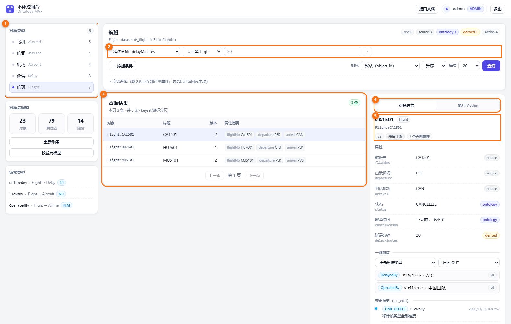
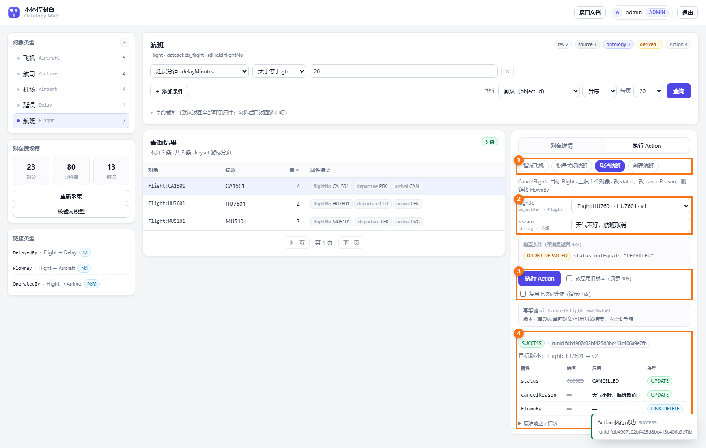

# 小学生也能看懂的本体控制台教程

这份教程只干一件事：让你在 5 分钟内把界面点一遍，并且知道每个东西为什么长这样。
不需要懂数据库，也不需要懂 Java。

---

## 一、先用三句话认识它

1. **它像一本点名册。**
   机场、航班、飞机、航司、延误，都是名册里的"对象"。左边那一列就是名册的分类。

2. **每个格子都有"主人"。**
   - 灰色格子（`source`）：上游系统给的，我们**只能看，不能改**；
   - 蓝色格子（`ontology`）：上游没有、我们自己记的（比如"取消原因"），**只有盖章机才能写**；
   - 黄色格子（`derived`）：算出来的（比如"延误分钟"），**谁都不能直接改**。

3. **所有改动都要"盖章"。**
   盖章机就是 **Action**。每盖一次，它都会记下：谁、什么时候、把哪个格子从什么改成了什么（这就是审计）。

---

## 二、开始之前

1. 确认应用在跑（终端里 `mvn spring-boot:run`）。
2. 浏览器打开 <http://localhost:8080/>。
3. 账号 `admin`、密码 `admin`（已经帮你填好了），点"进入控制台"。

看到左边有 5 个类型（机场、航班、飞机、航司、延误），就说明成功了。

---

## 三、先认一下界面（图上的 1~5）



| 编号 | 是什么 | 一句话解释 |
|---|---|---|
| 1 | 对象类型 | 名册的分类。点一下就能换一本名册 |
| 2 | 查询条件 | 筛子。写上条件，只留下符合条件的对象 |
| 3 | 结果表 | 一行就是一个对象，点一行看详情 |
| 4 | 两个标签 | "对象详情"和"执行 Action"在这里切换 |
| 5 | 对象头 | 它的 ID、版本号、是上游来的还是我们建的 |

---

## 四、任务 1：查"延误 20 分钟以上"的航班

照着点，不用记：

1. 点左边 **航班 Flight**；
2. 点 **＋ 添加条件**；
3. 第一个框选 **延误分钟 · delayMinutes**；
4. 第二个框选 **大于等于 gte**；
5. 第三个框填 **20**；
6. 点蓝色的 **查询**。

结果表应该只剩 **3 条**（CA1501 延误 20、HU7601 延误 60、MU5101 延误 35），
右上角的小绿标会显示"3 条"。

> 小知识：下面的"共 N 条"是单独问数据库要的，主查询本身不返回总数——这样翻页才快。
> 翻页用的是"从上一页最后一条往后找"，不是"跳过前 100 条"，所以翻到很后面也不会变慢。

---

## 五、任务 2：点开一个航班看看

点结果表第一行 **CA1501**，右边会出现它的详情：

- **航班号 / 出发 / 到达**：灰色 `source`，说明这些是上游给的；
- **状态 / 取消原因**：蓝色 `ontology`，说明这些是我们自己记的；
- **延误分钟**：黄色 `derived`，它是从"延误 D002"那条记录算出来的（20 分钟）；
- **一跳链接**：这架航班和"延误""飞机""航司"之间的关系；
- **变更历史**：谁在什么时候改过它，前值和后值都写着。

---

## 六、任务 3：取消一个航班（真的盖一次章）



1. 点右边的 **执行 Action** 标签；
2. 点 **取消航班**；
3. `flightId` 已经自动带上你刚才选中的航班，不用填；
4. `reason` 填一句原因，比如"天气不好"；
5. 点 **执行 Action**。

往下看，会出现：

- `SUCCESS` 和 `runId`（这次盖章的编号）；
- 目标版本，比如 `v2`（版本号每改一次就 +1）；
- 一张"前值 → 后值"的表：`status` 从什么变成了 `CANCELLED`，`cancelReason` 变成了你写的原因；
- 最下面"原始响应 / 请求"可以展开，看到完整的 JSON。

> 这一步背后发生了 8 件事（查幂等、验权限、验参数、锁行、验版本、验前置条件、改数据、写审计），
> 它们在一个事务里，要么全成功，要么全失败。

---

## 七、任务 4：同一个动作再点一次（幂等）

1. 勾上 **复用上次幂等键（演示重放）**；
2. 再点 **执行 Action**。

你会看到：

- 标记变成 **幂等重放**；
- `runId` 和上次一模一样；
- 数据没有再改一次（"变更历史"不会多出一条）。

这就是"同一张单子盖两次章，只算一次"。

---

## 八、任务 5：故意犯三个错

| 想看的错误 | 怎么点 | 会看到 |
|---|---|---|
| 版本冲突 | 勾 **故意用旧版本（演示 409）**，再执行 | 409 `CONFLICT`，提示期望版本和实际版本 |
| 超过批量上限 | 选 **批量关闭航班**，多选 4 个，执行 | 400 `LIMIT_EXCEEDED`，提示每批最多 3 个 |
| 没权限 | 右上角退出，用 `viewer` 登录，再执行 Action | 403 `FORBIDDEN`；而且左侧类型只剩 3 个，属性也变少了 |

`viewer` 登录后你会发现：Flight 的 `cancelReason`、`closeReason` **根本看不到**。
这不是界面藏起来了，是服务端在返回前就裁掉了——即使直接调接口也拿不到。

---

## 九、任务 6：看一眼"账本"

- 在详情里往下滚，就是 **变更历史（act_edit）**：谁、什么时候、哪个属性、前值、后值；
- 想看更完整的，可以打开 <http://localhost:8080/swagger-ui.html>，
  调 `GET /api/audit/runs/{runId}`，能看到一次执行的请求参数、结果和全部变更。

---

## 十、为什么会有这些"奇怪"现象

**1）为什么已经取消的航班还能再取消？**
因为 Action 里的前置条件只写了"状态不是 DEPARTED"，没写"已关闭不能取消"。
前置条件是元模型里配置的（`preconditions`），想更严格，加一条就行——不用改代码。

**2）为什么点了"重新采集"，取消时删掉的链接又回来了？**
采集是按上游事实重建链接的：上游还认为"这架飞机执飞这个航班"，所以链接被补回来了。
这是这一版已知的限制（README 第 12 节写了），下一期会给链接加"墓碑"来记住"这是被 Action 删掉的"。

**3）为什么新建的航班只有状态，没有航班号？**
航班号是上游属性（灰色 `source`），Action 不许写；新建对象只有"身份 + 我们自己的状态"，
等上游采集回填。这是"谁拥有这个格子"规则的直接结果。

---

## 十一、玩坏了怎么办

演示库可以随时推倒重来（会清空数据）：

```bash
docker compose down -v && docker compose up -d
mvn spring-boot:run
./demo.sh
```

---

## 十二、一张名词表（看不懂就回来查）

| 名词 | 小学生版解释 |
|---|---|
| 本体 | 一本"名册 + 规则本"：有哪些对象、每个格子归谁、允许怎么改 |
| 对象类型 | 名册的一页，比如"航班表"；它其实是在描述"数据从哪张表来、每列叫什么" |
| 对象 | 名册里的一行，比如 `Flight:MU5101` |
| 属性 | 行里的一个格子，比如"状态" |
| owner | 格子的主人：上游（source）、我们自己（ontology）、算出来的（derived） |
| Action | 唯一允许改格子的"盖章机"，一次盖章=一个事务 |
| 版本号 | 这个对象被改过几次；改之前要报"我看到的是第几版"，对不上就不让改（409） |
| 幂等键 | 这次盖章的"单号"；同一个单号再盖，只返回上次结果，不会改两次 |
| 审计 | 账本：谁、什么时候、把什么从什么改成了什么 |
| 下推 | 不是把整本名册搬到办公室再挑，而是让数据库直接按条件把结果找出来 |
| keyset 分页 | 从"上一页最后一条"往后接着找，而不是从头数（所以不用 OFFSET） |

---

看完这篇，再回去点一遍任务 1~6，你基本就把这个系统"玩明白"了。
